<div align="center">

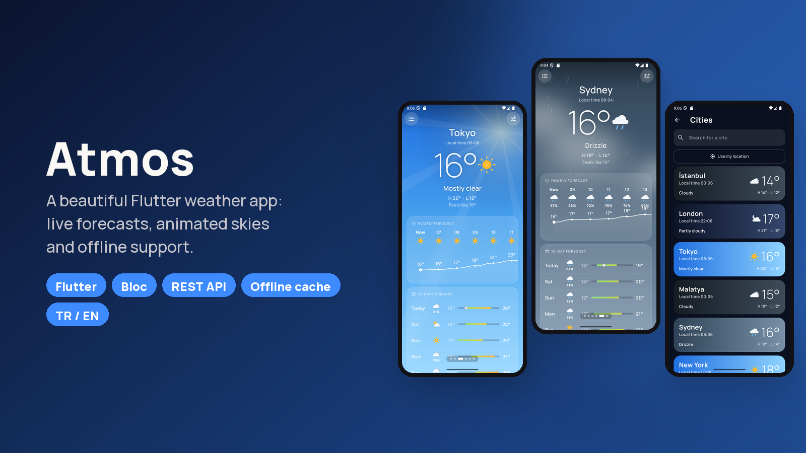

# Atmos · Flutter Hava Durumu Uygulaması

Herkese açık bir REST API üzerine kurulmuş, özenle tasarlanmış bir hava durumu uygulaması:
- Anlık hava, saatlik ve 10 günlük tahmin, hava kalitesi.
- Şehir arama ve GPS konumu.
- Çevrimdışı önbellek.
- Havaya ve günün saatine göre değişen hareketli bir gökyüzü.

[](https://flutter.dev)
[](https://dart.dev)
[](https://bloclibrary.dev)
[](https://github.com/SafaSenturk/flutter-weather-app/actions/workflows/ci.yml)
[](LICENSE)

**[⬇️ APK'yı indir](https://github.com/SafaSenturk/flutter-weather-app/releases/latest)** · [🇬🇧 English](#-english)

</div>

---

## Demo

<p align="center">
  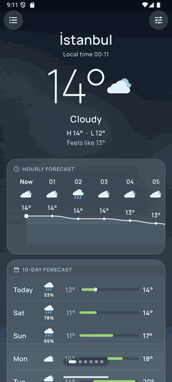
</p>

## Özellikler

**Tahmin**
- Anlık durum: sıcaklık, hissedilen sıcaklık, günün en yüksek/en düşük değeri ve şehrin **yerel saati**.
- Önümüzdeki 24 saat için yumuşak bir sıcaklık eğrisiyle çizilen **saatlik tahmin** ve yağış ihtimalleri.
- Soğuktan sıcağa renklenen aralık çubuklarıyla **10 günlük tahmin**.
- Ayrıntı kartları:
  - **Rüzgâr pusulası** ve **gün doğumu/batımı yayı**.
  - UV indeksi ve nem.
  - **Hava kalitesi** (Avrupa AQI, PM2.5, PM10).
  - Yağış, basınç ve görüş mesafesi.

**Şehirler**
- Telefonun kendi hava durumu uygulamasındaki gibi kayıtlı şehirler arasında kaydırarak geçiş.
- **Şehir arama**: Türkçe ya da İngilizce sonuçlar, bayraklar ve bölgelerle; gecikmeli (debounce) çalışır.
- İzin yönetimi düzgün yapılmış **konumumu kullan** (GPS + ters geocoding).
- Sürükle-bırakla sıralama, kaydırarak silme.

**Tasarım**
- Her hava durumu için gece ve gündüz tam ekran **hareketli gökyüzü**:
  - Güneş ışınları, yıldızlar, süzülen bulutlar.
  - Yağmur, kar, sis ve şimşek.
  - Hepsi `CustomPainter` ile çizildi.
- İkon paketi değil, **elle çizilmiş hava ikonları**; buzlu cam kartlar.

**Güvenilirlik**
- **Önce çevrimdışı:** her şehrin son tahmini cihazda saklanır. Bağlantı yokken boş ekran yerine bu veri, açık bir "Çevrimdışı" uyarısıyla gösterilir.
- Kayıtlı veri anında görünür, sonra arka planda yenilenir (*stale-while-revalidate*).
- Her durumun kendi ekranı var ve hepsinde toparlanma yolu sunuluyor:
  - Yükleniyor yer tutucuları.
  - Boş arama sonucu.
  - Çevrimdışı.
  - Zaman aşımı.
  - Sunucu hatası.
  - Reddedilen konum izni.
- **Birimler:** °C / °F ve km/s, m/s, mph; veri yeniden indirilmeden anında değişir.
- **Türkçe ve İngilizce**.

## Ekran görüntüleri

| Açık sabah | Yağmur | Gece | Öğleden sonra |
|:---:|:---:|:---:|:---:|
| 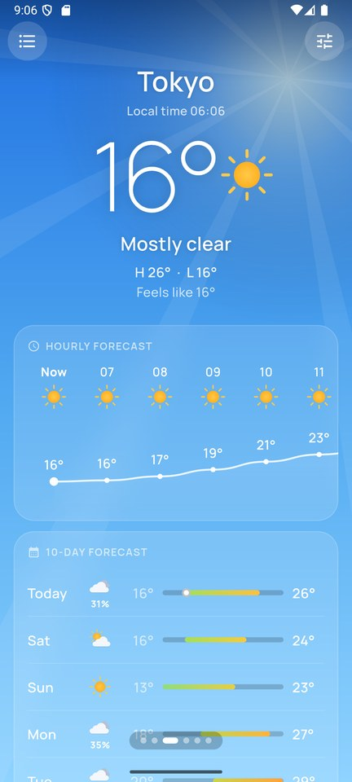 | 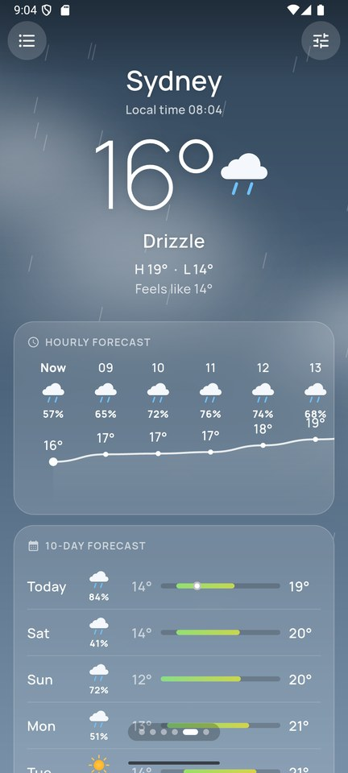 | 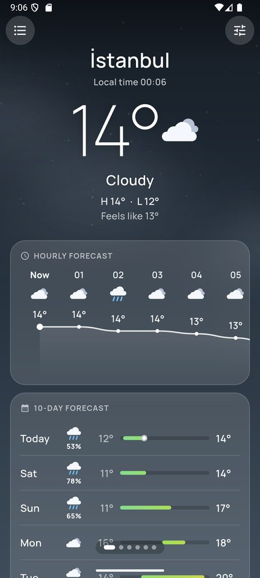 | 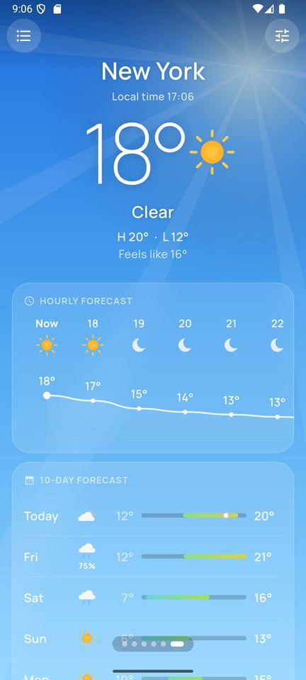 |
| **Ayrıntılar** | **10 günlük tahmin** | **Şehirler** | **Arama** |
| 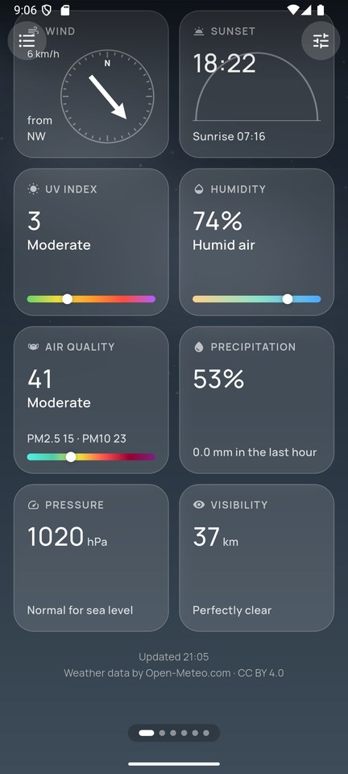 | 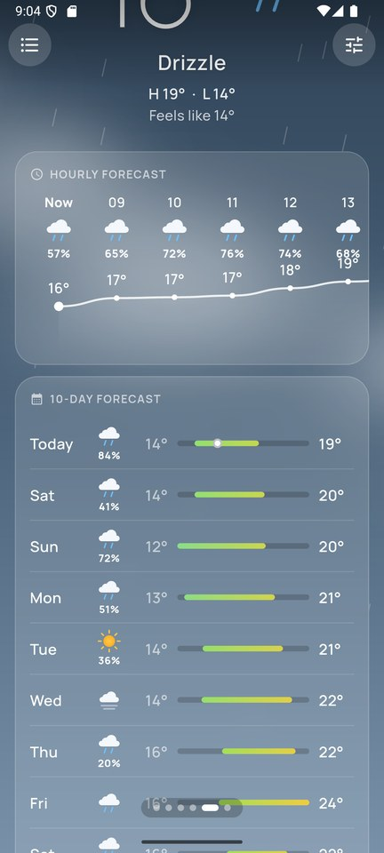 | 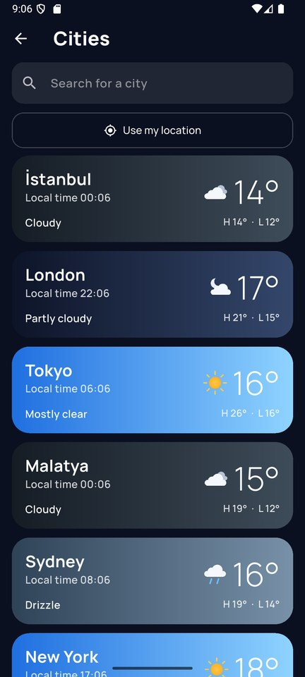 | 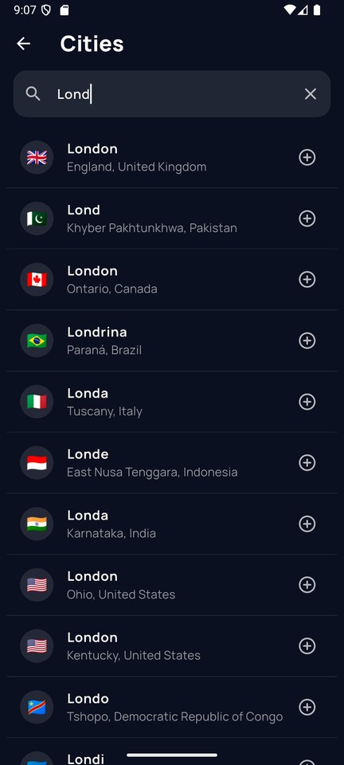 |
| **Ayarlar** | **Çevrimdışı (kayıtlı veri)** | **Hata durumu** | **Türkçe + °F** |
| 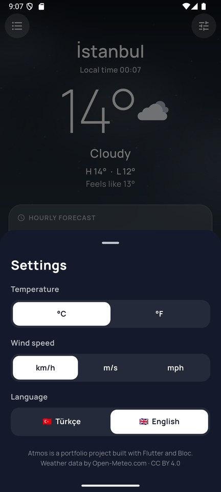 | 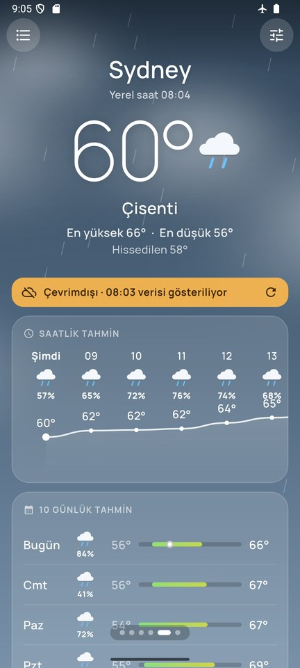 | 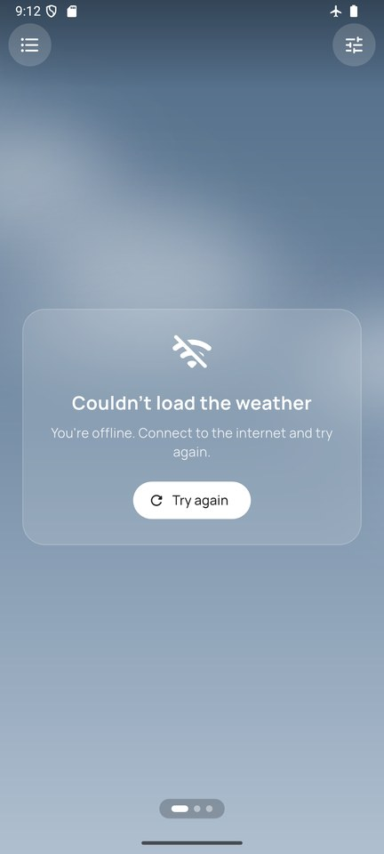 | 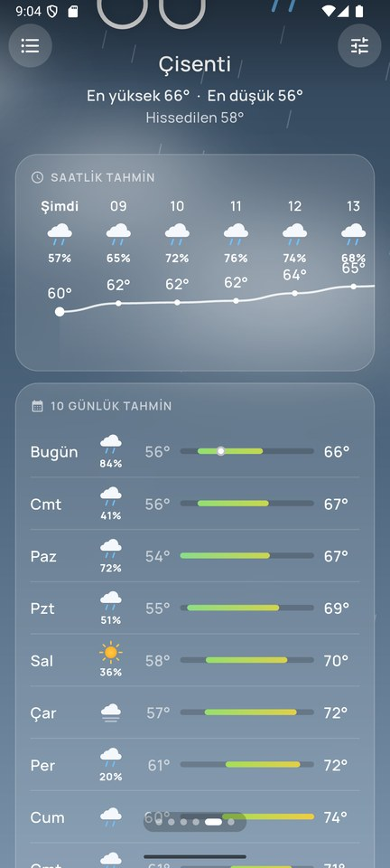 |

## Teknolojiler

| Alan | Seçim |
|---|---|
| Arayüz | Flutter 3.44, Material 3, `CustomPainter` animasyonları, `BackdropFilter` cam efekti, gömülü Manrope fontu |
| State management | **flutter_bloc 9**: olay dönüştürücülü `Bloc` (`restartable`, `droppable`, debounce) ve `Cubit` |
| Ağ | **Dio**, kullanıcıya gösterilen mesajlara çevrilen tek bir `WeatherFailure` türü |
| API'ler | [Open-Meteo](https://open-meteo.com) tahmin, hava kalitesi ve geocoding (API anahtarı gerekmez) · BigDataCloud ters geocoding |
| Konum | `geolocator` |
| Saklama | `shared_preferences` (şehirler, ayarlar, önbelleğe alınmış tahminler) |
| Yerelleştirme | ARB dosyaları + `gen-l10n`, Türkçe ve İngilizce |
| Test / CI | `bloc_test`, `mocktail`, gerçek API yanıtlarıyla test verileri, GitHub Actions |

## Mimari

```
lib/
├── main.dart                     # Bağımlılık kurulumu: Dio → API → repository'ler → bloc'lar
├── core/
│   ├── format.dart               # Birim dönüşümü + yerelleştirilmiş etiketler
│   └── widgets/                  # SkyBackground, WeatherIcon, GlassCard
├── data/
│   ├── api/weather_api.dart      # Open-Meteo + ters geocoding, hata eşleme
│   ├── models/                   # Forecast, City, WeatherCondition (WMO kodları)
│   └── repositories/             # WeatherRepository (bellek + disk önbelleği), CityRepository (arama, GPS)
├── features/
│   ├── weather/                  # WeatherBloc (her şehir sayfası için bir tane) + ana sayfa kaydırıcısı + kartlar
│   ├── cities/                   # CitiesCubit (kayıtlı liste), CitySearchBloc (gecikmeli arama)
│   └── settings/                 # SettingsCubit (birimler, dil)
└── l10n/                         # app_en.arb, app_tr.arb
```

**Veri akışı:** Arayüz → `WeatherBloc` → `WeatherRepository` → `WeatherApi`.
- Veri 10 dakikadan yeniyse repository bellekten cevap verir; değilse indirir ve ham yanıtı kaydeder.
- İndirme başarısız olursa kayıtlı kopyayı *eski (stale)* olarak işaretleyip döndürür; bloc da çevrimdışı uyarısını gösterir.
- Ekran yalnızca hiç kayıtlı veri yoksa hata durumuna geçer.

**Saat dilimleri** açıkça ele alınır. Open-Meteo yerel duvar saatlerini döndürür ve bunlar "o şehirde şu an" (`UTC + utc_offset`) ile karşılaştırılır. Böylece telefon hangi saat diliminde olursa olsun saatlik liste doğru çıkar.

## Kendin çalıştır

```bash
git clone https://github.com/SafaSenturk/flutter-weather-app.git
cd flutter-weather-app
flutter pub get
flutter run
```

```bash
flutter test      # 20 test: bloc'lar, repository, ayrıştırma (gerçek API verisiyle), birimler
flutter analyze   # sıkı lint kuralları, sorun yok
```

API anahtarı gerekmez.

**Denemek için:** [Releases](https://github.com/SafaSenturk/flutter-weather-app/releases/latest) sayfasından APK'yı indirip Android telefonuna kurabilirsin.

API entegrasyonlu bir uygulamaya mı ihtiyacın var (hava durumu, döviz, kendi REST servisin…)? **[safasenturk.github.io](https://safasenturk.github.io)**

### 🧩 Bu projeden çıkan eklentiler

Bu uygulamadaki şu parçaları başka projelerde de kullanılabilsin diye **[Plugins](https://github.com/SafaSenturk/Plugins)** reposuna ekledim. Oradan erişip kendi projene kopyalayabilirsin:

- **[flutter-weather-sky](https://github.com/SafaSenturk/Plugins/tree/main/flutter-weather-sky)**: hareketli gökyüzü, elle çizilmiş hava ikonları ve WMO kodları.
- **[flutter-offline-cache](https://github.com/SafaSenturk/Plugins/tree/main/flutter-offline-cache)**: internet yokken son veriyi gösteren önce çevrimdışı önbellek.

---

## 🇬🇧 English

**Atmos** is a polished weather app built on a public REST API:
- Live conditions, hourly and 10-day forecasts, air quality.
- City search and GPS location.
- An offline cache.
- An animated sky that changes with the weather and the time of day.

The demo and screenshots are shown above. **[⬇️ Download the APK](https://github.com/SafaSenturk/flutter-weather-app/releases/latest)**

### Features

**Forecast**
- Current conditions: temperature, "feels like", today's high/low and the city's **local time**.
- **Hourly forecast** for the next 24 hours drawn as a smooth temperature curve, with rain chances.
- **10-day forecast** with temperature range bars coloured from cold to warm.
- Detail tiles:
  - **Wind compass** and **sunrise/sunset arc**.
  - UV index and humidity.
  - **Air quality** (European AQI, PM2.5, PM10).
  - Precipitation, pressure and visibility.

**Cities**
- Swipe between saved cities like the system weather apps.
- **City search** with debounce: results in Turkish or English, with flags and regions.
- **Use my location** (GPS + reverse geocoding) with proper permission handling.
- Reorder by drag and drop, swipe to remove.

**Design**
- Full-screen **animated sky** for every condition, day and night:
  - Sun rays, stars, drifting clouds.
  - Rain, snow, fog and lightning.
  - All drawn with `CustomPainter`.
- **Hand-drawn weather icons** (no icon pack), frosted-glass cards.

**Reliability**
- **Offline first:** the last forecast of every city is saved on the device. Without a connection the app shows it with a clear "offline" banner instead of an empty screen.
- Saved data appears instantly, then refreshes in the background (*stale-while-revalidate*).
- Every state has its own screen, each with a way to recover:
  - Loading placeholders.
  - Empty search.
  - Offline.
  - Timeout.
  - Server error.
  - Location denied.
- **Units:** °C / °F and km/h, m/s, mph; switched instantly, no refetch.
- **Turkish and English**.

### Tech stack

| Area | Choice |
|---|---|
| UI | Flutter 3.44, Material 3, `CustomPainter` animations, `BackdropFilter` glass, bundled Manrope font |
| State management | **flutter_bloc 9**: `Bloc` with event transformers (`restartable`, `droppable`, debounce) and `Cubit` |
| Networking | **Dio**, one `WeatherFailure` type mapped to user-facing messages |
| APIs | [Open-Meteo](https://open-meteo.com) forecast, air-quality and geocoding (no API key) · BigDataCloud reverse geocoding |
| Location | `geolocator` |
| Persistence | `shared_preferences` (cities, settings, cached forecasts) |
| Localization | ARB files + `gen-l10n`, Turkish & English |
| Testing / CI | `bloc_test`, `mocktail`, real API fixtures, GitHub Actions |

### Architecture

The folder tree is shown in the Turkish section above.

**Data flow:** UI → `WeatherBloc` → `WeatherRepository` → `WeatherApi`.
- The repository answers from memory if the data is less than 10 minutes old; otherwise it downloads it and saves the raw response.
- If the download fails, it returns the saved copy marked as *stale*, so the bloc can show the offline banner.
- The screen switches to the error state only when nothing was ever saved.

**Time zones** are handled explicitly. Open-Meteo returns local wall-clock times, which are compared with "now in that city" (`UTC + utc_offset`), so the hourly list is correct whatever time zone the phone is in.

### Run it yourself

```bash
git clone https://github.com/SafaSenturk/flutter-weather-app.git
cd flutter-weather-app
flutter pub get
flutter run
flutter test      # 20 tests: blocs, repository, parsing (real API fixtures), units
```

No API key needed.

Need an app connected to an API (weather, currency, your own REST service…)? **[safasenturk.github.io](https://safasenturk.github.io)**

### 🧩 Reusable plugins from this app

These parts of the app are available in the **[Plugins](https://github.com/SafaSenturk/Plugins)** repo, ready to copy into your own project:

- **[flutter-weather-sky](https://github.com/SafaSenturk/Plugins/tree/main/flutter-weather-sky)**: the animated sky, hand-drawn weather icons and WMO codes.
- **[flutter-offline-cache](https://github.com/SafaSenturk/Plugins/tree/main/flutter-offline-cache)**: the offline-first cache that shows the last data without a connection.

---

<div align="center">

**[Safa Şentürk](https://github.com/SafaSenturk)** · Flutter Mobil Geliştirici · Flutter Mobile Developer · [Portföy / Portfolio](https://safasenturk.github.io)

<sub>Hava durumu verileri / Weather data: <a href="https://open-meteo.com">Open-Meteo.com</a> (CC BY 4.0).</sub>

</div>
